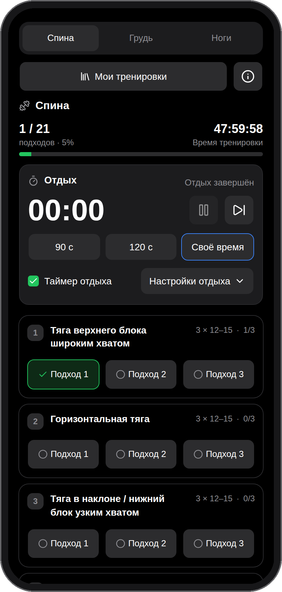
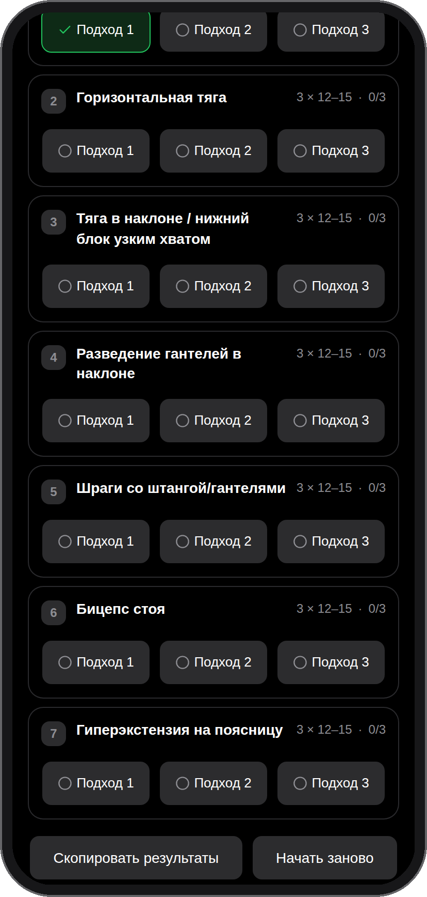

# Trenbolon

Веб-приложение для ведения тренировок: упражнения, отметки подходов и таймер отдыха в одном интерфейсе.

[Открыть приложение](https://trenbolon.malakhov.su)

## Возможности

- Встроенные шаблоны и библиотека собственных тренировок.
- Импорт и экспорт тренировок в JSON, готовая инструкция для ИИ-агента ([формат](docs/import-export.md)).
- Редактор упражнений: порядок, подходы, повторения и вес.
- Прогресс текущей сессии и копирование результатов текстом.
- Таймер отдыха с паузой, звуковым сигналом и выключателем, независимым от звука.
- Отдых между подходами (90 с, 120 с или своё время) и отдельный, более длинный отдых между упражнениями — целое число секунд от 1 до 3600.
- Общее время тренировки: отсчёт с первого отмеченного подхода, с остановкой на последнем.
- Автоматическое сохранение сессии и собственных тренировок в браузере.
- Тёмный интерфейс, адаптированный для телефона и работы с клавиатуры.

Регистрация и отдельный сервер данных не нужны. Данные хранятся в `localStorage`, не синхронизируются между устройствами и удаляются при очистке данных сайта. Звук в фоне и при заблокированном экране зависит от ограничений браузера и ОС.

## Скриншоты

Мобильный вид в браузере (390 × 844), не съёмка с физического телефона.

<p>
  
  
</p>

## Разработка

Стек: Next.js (App Router), React, TypeScript, Tailwind CSS и shadcn/ui.

```bash
npm ci
npm run dev
```

Приложение будет доступно на `http://localhost:3000`.

```bash
npm test           # тесты Vitest и Testing Library
npm run lint       # ESLint
npm run typecheck  # проверка типов
npm run build      # production-сборка
npm start          # запуск production-сборки
```

Для контейнерного запуска есть `Dockerfile` и `compose.yaml`. Compose рассчитан на существующую внешнюю сеть обратного прокси.

## Устройство проекта

- `app/`: страницы и общие стили.
- `components/`: интерфейс, редактор и управление сессией.
- `lib/`: состояние, локальное хранение, таймер и звук.
- `docs/`: технические детали хранения и фонового аудио.
